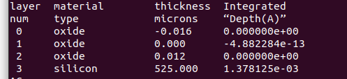
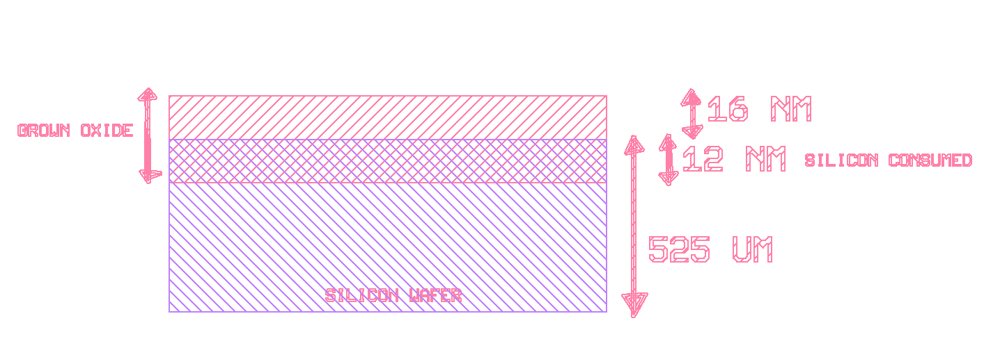
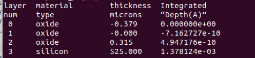
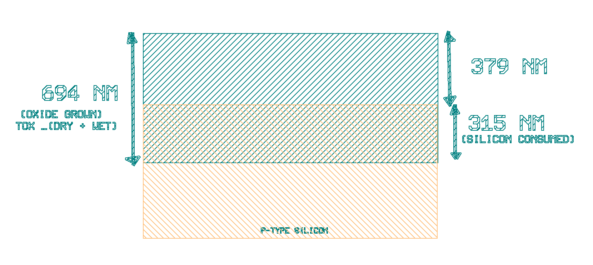
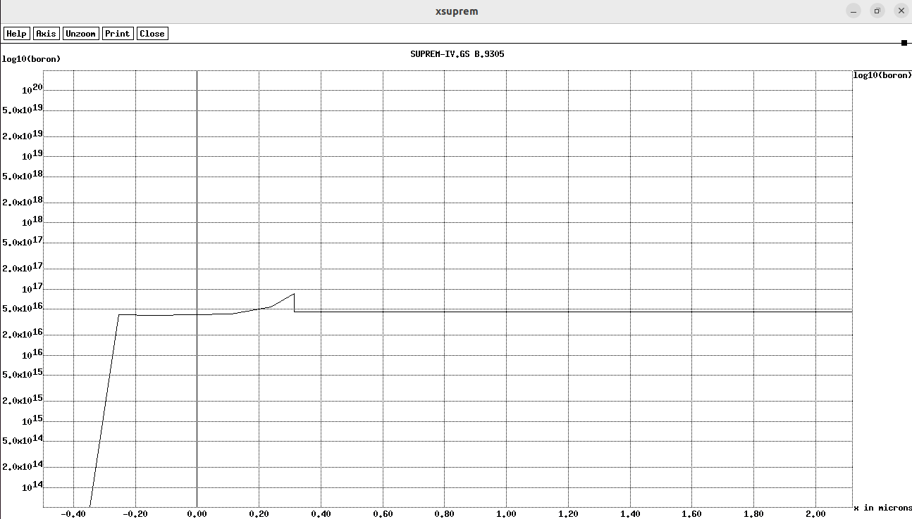
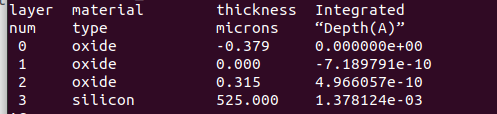
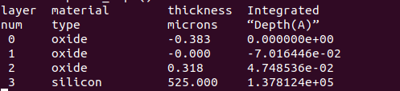
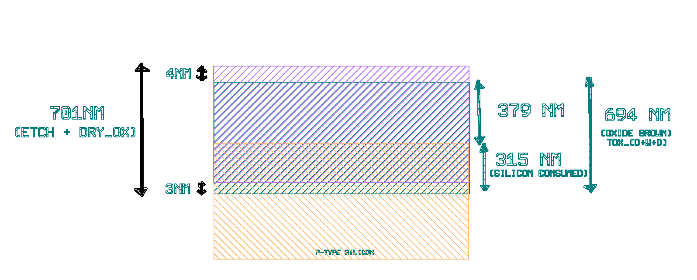
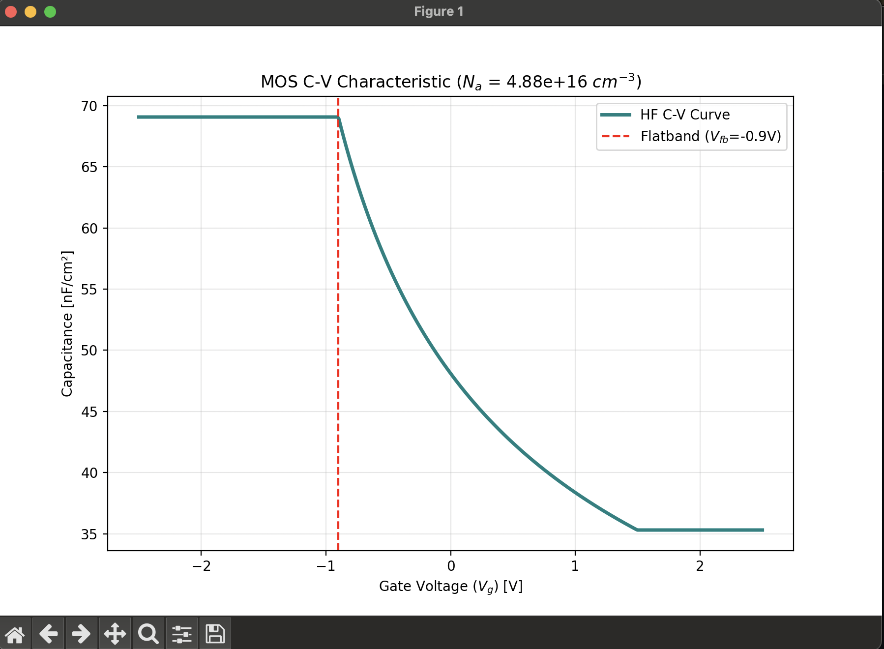

# SUPREM-IV TCAD Simulation of a CMOS Process Flow and MOS C–V Modelling

This project simulates the front end of a CMOS process on a boron-doped silicon wafer in SUPREM-IV.GS: dry, wet and dry oxidation, then lithography and BHF etch of the gate area, then gate oxide growth. It checks the simulated oxide thicknesses against hand calculations with the Deal–Grove model, looks at how boron redistributes between Si and SiO₂, and models the high-frequency C–V curve of the resulting MOS capacitor in Python.

| | |
|---|---|
| **Course** | ELL7303/ELL730 term paper, IIT Delhi |
| **Supervisor** | Prof. Madhusudan Singh |
| **Date** | March 2026 (Winter semester) |
| **Team** | Group A9: Kabir Kashyap, Humanshu Gajbhiye, Ruchika Kant |

## Problem

Start with a prime-grade 100 mm, 525 µm thick <100> Si wafer, boron doped, resistivity 0.32 Ω·cm, and run this flow:

| Step | Process |
|---|---|
| 1 | Dry oxidation, 1100 °C, 100% O₂, 1 atm, 5 min |
| 2 | Wet oxidation, 1100 °C, 92% H₂O / 8% N₂, 1 atm, 60 min |
| 3 | Dry oxidation, same as step 1 |
| 4–12 | Pre-clean, HMDS, AZ 5214-E resist, prebake, expose (active/gate mask), develop, rinse, postbake, O₂ descum |
| 13–16 | BHF etch 7 min, DI quench, cascade rinse, resist strip |
| 17 | Gate oxide: RCA clean, then dry oxidation at 1000 °C for 60 min |

The tasks were: (a) oxide thickness and Si consumed after steps 1–3, (b) boron profiles in Si and SiO₂ after steps 1–3, and (c) the Deal–Grove A and B and the C–V curve after step 17.

## Repository layout

```
suprem/
  01_dry_oxidation_thickness.in   01_dry_oxidation_profile.in
  02_wet_oxidation_thickness.in   02_wet_oxidation_profile.in
  03_dry_oxidation_thickness.in   03_dry_oxidation_profile.in
  17_gate_oxide_thickness.in      17_gate_oxide_profile.in
python/
  mos_cv_curve.py
docs/images/                      figures from the report
```

Each step has two decks. The `_thickness` deck prints the layer table (oxide and silicon thicknesses). The `_profile` deck runs in 1D mode and plots log₁₀ of the boron concentration against depth. Steps 4–16 have no deck of their own because they don't change the 1D oxide stack until the BHF etch, which is part of the step 17 decks.

## Substrate doping

For p-type Si, ρ = 1 / (q·Nₐ·µₚ). With ρ = 0.32 Ω·cm and µₚ ≈ 400 cm²/V·s:

Nₐ = 1 / (1.6×10⁻¹⁹ × 0.32 × 400) ≈ 4.88×10¹⁶ cm⁻³

## Analytical estimates (Deal–Grove)

x² + A·x = B·(t + τ), where τ = (x₀² + A·x₀) / B accounts for the oxide x₀ already present.

The textbook rate constants at 1100 °C are given for 640 Torr. Since B ∝ pressure, they were scaled to 760 Torr: B₇₆₀ = B₆₄₀ × 760 / 640.

| Step | A (µm) | B (µm²/hr) | Starting oxide | Oxide after step |
|---|---|---|---|---|
| 1, dry 5 min | 0.09 | 0.0321 | 0 | 23.5 nm |
| 2, wet 60 min | 0.11 | 0.606 | 23.5 nm | 661 nm |
| 3, dry 5 min | 0.09 | 0.0321 | 661 nm | 661.5 nm |
| 17, dry 60 min | 0.09 | 0.0321 | 661.5 nm | 684.4 nm |

## SUPREM-IV results

| Step | Total oxide | Si consumed | Si consumed / oxide |
|---|---|---|---|
| 1 | 28 nm | 12 nm | ≈ 0.43 |
| 2 | 694 nm | 315 nm | ≈ 0.45 |
| 3 | 694 nm | no change | see the step 3 note below |
| 17 | 701 nm | 318 nm | |

About 44% of the oxide thickness comes from consumed silicon, which matches the textbook ratio of about 0.44.

Step 1 (dry oxidation):





Step 2 (dry + wet):





Step 3 (dry + wet + dry):




Step 17 (etch + gate oxidation):





**Boron redistribution.** Boron's segregation coefficient k = C_Si / C_SiO₂ is less than 1. This means boron prefers the oxide, so the growing oxide takes boron away from the silicon surface. The profile plots show the boron level jumping sharply at the Si/SiO₂ interface rather than staying flat.

**Why SUPREM and Deal–Grove disagree.** Plain Deal–Grove assumes undoped silicon and fixed rate constants. SUPREM-IV uses its own temperature-dependent coefficients, models dopant effects and segregation at the moving interface, and handles the thin-oxide regime differently. The largest gap is in step 1: 28 nm simulated against 23.5 nm analytical, which is typical of the fast initial growth that Deal–Grove under-predicts for thin dry oxides.

## MOS C–V curve

SUPREM-IV has no electrical simulation, so `python/mos_cv_curve.py` computes the high-frequency C–V curve analytically:

- C_total = C_ox·C_s / (C_ox + C_s), with C_ox = ε_ox / t_ox.
- In depletion, the surface potential ψₛ comes from V_G − V_FB = ψₛ + √(2·q·ε_Si·Nₐ·ψₛ) / C_ox.
- In inversion, ψₛ is held at 2φ_F, so the depletion width stops growing and C stays at its minimum.

Inputs: Nₐ = 4.88×10¹⁶ cm⁻³ (from the resistivity), t_ox = 50 nm, V_FB = −0.9 V.

Outputs: C_ox ≈ 69 nF/cm² in accumulation, falling to about 35 nF/cm² in inversion from around +1.5 V.



## Running

- **SUPREM-IV.GS:** run each deck with `suprem <deck>.in`. The `_profile` decks open the `xsuprem` plot window.
- **Python:** `pip install numpy matplotlib`, then `python python/mos_cv_curve.py`.

## Notes and known issues

The decks are kept exactly as they were run for the report. Reading them again, these are worth knowing:

- **Boron concentration.** The decks use `init boron conc=4.48e16`, but the calculated value is 4.88×10¹⁶ cm⁻³. This is a typo. At this doping level it has a negligible effect on oxide growth.
- **Step 3.** In `03_dry_oxidation_thickness.in`, the last `diffuse ... dry` line is commented out. So the step 3 layer table is really the step 2 result again, which is why it shows no change. The step 3 profile deck does include the final dry oxidation. Deal–Grove predicts only about 0.5 nm extra growth, so the thickness barely changes either way.
- **Etch syntax.** The gate-area etch is written as four `etch oxide start` lines. In SUPREM-IV.GS a polygon etch is normally `start`, then `continue`, then `done`. So the oxide may not actually have been removed. That fits the step 17 result: only about 7 nm of extra growth on top of 694 nm, rather than a fresh gate oxide growing on bare silicon.
- **Step 17 hand calculation.** It used the 1100 °C rate constants and the full 661.5 nm as starting oxide. The problem specifies 1000 °C on the etched gate area.
- **Wet oxidation hand calculation.** It used the full-pressure steam constants without scaling for the 0.92 H₂O fraction.
- **C–V oxide model.** The C–V script assumes a single 50 nm gate oxide with εᵣ = 3.9, which is what you would expect from 1000 °C / 60 min dry oxidation on bare silicon. It does not use the SUPREM oxide stack. The report discusses treating dry and wet oxide (εᵣ 3.9 and 3.7) as capacitors in series, but the script does not implement that.

## Contributions

From the report's statement of contributions:

| Member | Work |
|---|---|
| Kabir Kashyap | Analytical expressions and numerical estimates for the oxide thicknesses; worked on the C–V curve |
| Humanshu Gajbhiye | Executed the SUPREM codes; analysed the device cross-section at each step |
| Ruchika Kant | Developed and executed the SUPREM codes and the Python C–V code; LaTeX report and diagrams; contributed to the numerical estimates |
